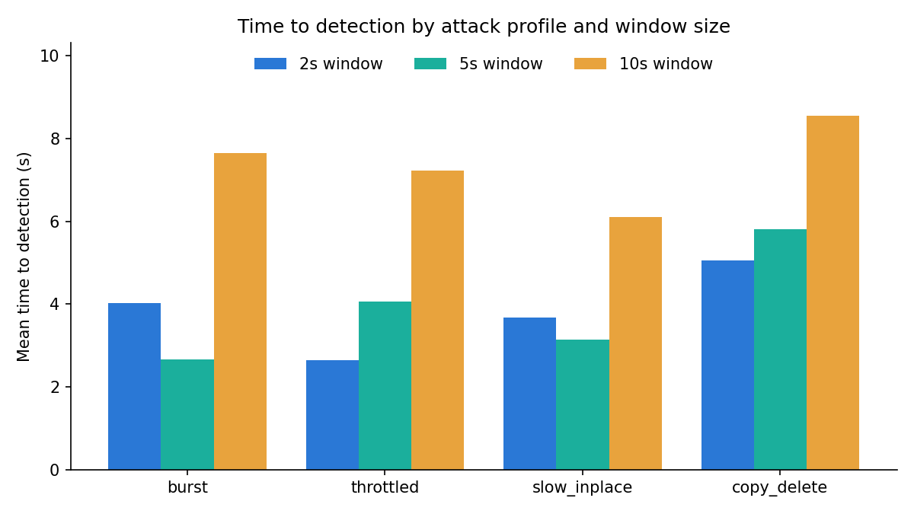
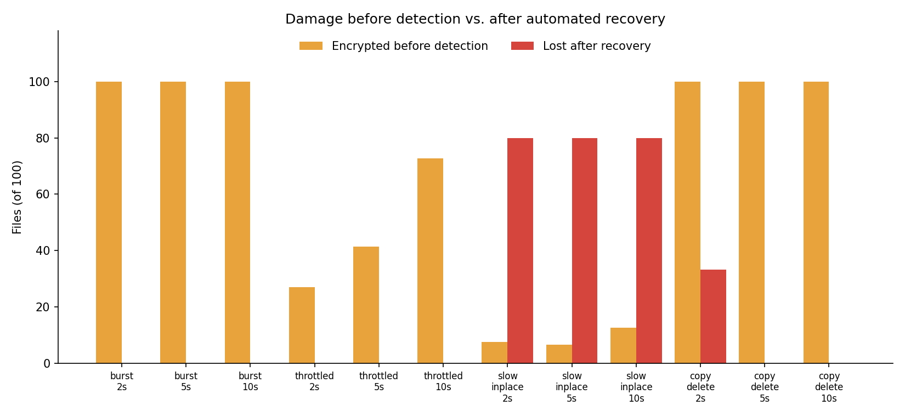

# EarlyShield — Real-Time Evaluation Results

Generated 2026-10-22 14:57 UTC on win32, Python 3.12.10, PollingObserver · corpus of 100 files · auto-response threshold 0.75 · 3 trial(s) per attack configuration.

## Ransomware simulations

TTD = time from the attacker's first encrypted file to the model flagging a window. "Before detection" = files the attacker had already encrypted at that moment. "Lost" = corpus files not byte-identical to the original at the end of the trial, after automated recovery. "Responded" = the detection's confidence reached the auto-response threshold, so files were quarantined and restored; below it EarlyShield only raises an alert. "Confidence" = mean of each trial's highest flagged-window confidence. "Attribution" = share of flagged windows blamed on the attacker's PID.

| Attack | Window | Detected | Responded | Confidence | TTD (s) | Encrypted before detection | Encrypted total | Lost after recovery | Artifacts left | Attribution |
|---|---|---|---|---|---|---|---|---|---|---|
| burst | 2s | 3/3 | 3/3 | 0.94 | 4.0 ± 2.1 | 100.0 ± 0.0 | 100 ± 0 | 0.0 ± 0.0 | 0.0 ± 0.0 | 0% |
| burst | 5s | 3/3 | 3/3 | 0.95 | 2.7 ± 0.6 | 100.0 ± 0.0 | 100 ± 0 | 0.0 ± 0.0 | 0.0 ± 0.0 | 0% |
| burst | 10s | 3/3 | 3/3 | 0.92 | 7.7 ± 4.3 | 100.0 ± 0.0 | 100 ± 0 | 0.0 ± 0.0 | 0.0 ± 0.0 | 0% |
| throttled | 2s | 3/3 | 3/3 | 0.94 | 2.6 ± 0.7 | 27.0 ± 6.6 | 100 ± 0 | 0.0 ± 0.0 | 0.0 ± 0.0 | 0% |
| throttled | 5s | 3/3 | 3/3 | 0.93 | 4.1 ± 2.4 | 41.3 ± 23.8 | 100 ± 0 | 0.0 ± 0.0 | 0.0 ± 0.0 | 0% |
| throttled | 10s | 3/3 | 3/3 | 0.93 | 7.2 ± 1.2 | 72.7 ± 12.1 | 100 ± 0 | 0.0 ± 0.0 | 0.0 ± 0.0 | 0% |
| slow_inplace | 2s | 3/3 | 0/3 | 0.57 | 3.7 ± 1.8 | 7.7 ± 3.8 | 80 ± 0 | 80.0 ± 0.0 | 0.0 ± 0.0 | 0% |
| slow_inplace | 5s | 3/3 | 0/3 | 0.55 | 3.1 ± 1.9 | 6.7 ± 3.5 | 80 ± 0 | 80.0 ± 0.0 | 0.0 ± 0.0 | 0% |
| slow_inplace | 10s | 3/3 | 0/3 | 0.54 | 6.1 ± 0.9 | 12.7 ± 2.1 | 80 ± 0 | 80.0 ± 0.0 | 0.0 ± 0.0 | 0% |
| copy_delete | 2s | 3/3 | 2/3 | 0.84 | 5.1 ± 1.7 | 100.0 ± 0.0 | 100 ± 0 | 33.3 ± 57.7 | 33.7 ± 58.3 | 0% |
| copy_delete | 5s | 3/3 | 3/3 | 0.85 | 5.8 ± 0.5 | 100.0 ± 0.0 | 100 ± 0 | 0.0 ± 0.0 | 0.0 ± 0.0 | 0% |
| copy_delete | 10s | 3/3 | 3/3 | 0.89 | 8.5 ± 1.6 | 100.0 ± 0.0 | 100 ± 0 | 0.0 ± 0.0 | 0.0 ± 0.0 | 0% |

**Overall:** 36/36 attack trials detected; mean TTD 5.05 s; mean 64.0% of the corpus encrypted before detection; mean 22.8% lost after recovery; mean automated response time 2054 ms.

## Benign workloads (false positives)

A false positive here also triggers the automated response, so "Collateral actions" counts the quarantine/restore actions EarlyShield took on legitimate activity (all reversible: quarantined files are moved into the vault, not deleted).

| Workload | Window | Flagged trials | Flagged windows | Max confidence | Collateral actions |
|---|---|---|---|---|---|
| edit_docs | 2s | 0/1 | 0/8 | — | 0 |
| edit_docs | 5s | 0/1 | 0/4 | — | 0 |
| edit_docs | 10s | 0/1 | 0/2 | — | 0 |
| bulk_rename | 2s | 0/1 | 0/1 | — | 0 |
| bulk_rename | 5s | 0/1 | 0/1 | — | 0 |
| bulk_rename | 10s | 0/1 | 0/1 | — | 0 |
| zip_archive | 2s | 0/1 | 0/1 | — | 0 |
| zip_archive | 5s | 0/1 | 0/1 | — | 0 |
| zip_archive | 10s | 0/1 | 0/1 | — | 0 |
| copy_folder | 2s | 0/1 | 0/1 | — | 0 |
| copy_folder | 5s | 0/1 | 0/1 | — | 0 |
| copy_folder | 10s | 0/1 | 0/1 | — | 0 |
| format_conversion | 2s | 0/1 | 0/1 | — | 0 |
| format_conversion | 5s | 0/1 | 0/1 | — | 0 |
| format_conversion | 10s | 0/1 | 0/1 | — | 0 |

**Overall:** 0/15 benign trials produced at least one false alarm (0/26 windows).

## Charts

