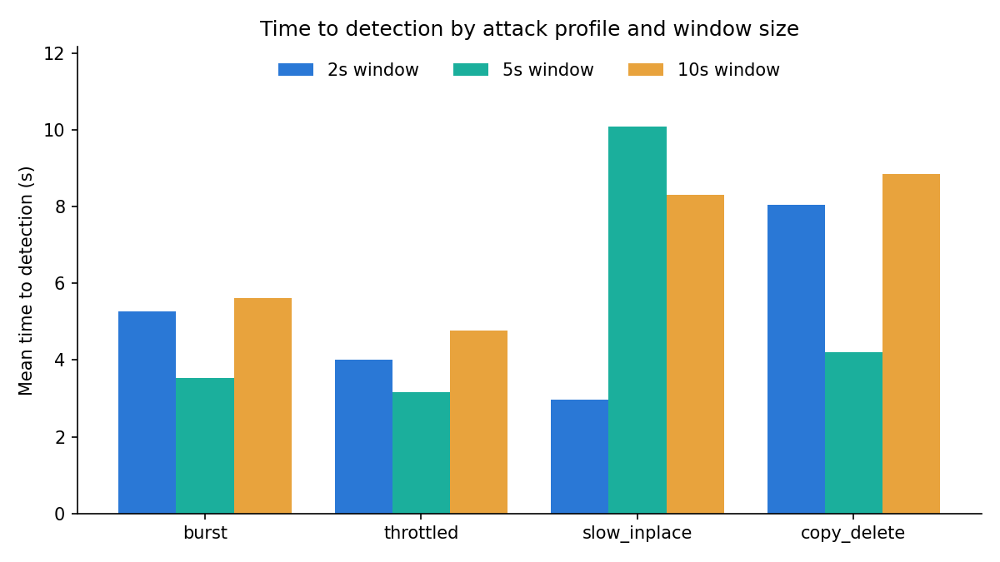
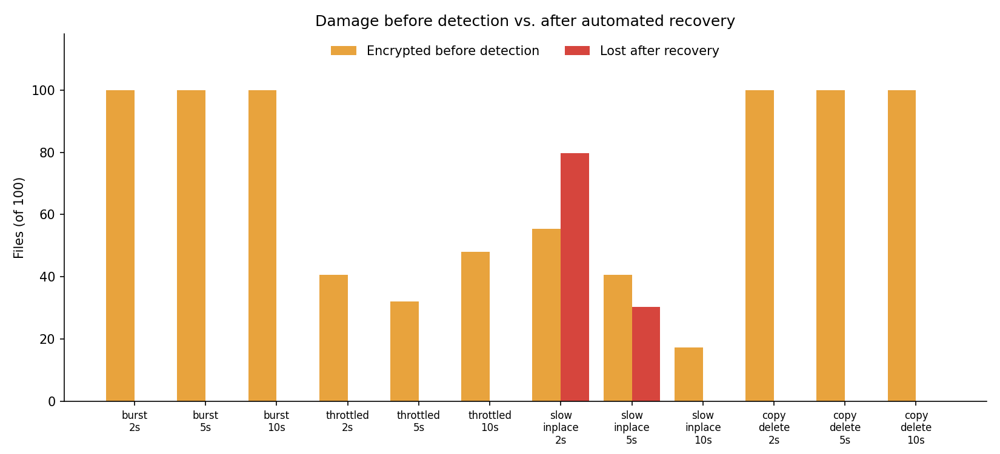

# EarlyShield — Real-Time Evaluation Results

Generated 2026-10-25 07:02 UTC on win32, Python 3.12.10, PollingObserver · corpus of 100 files · auto-response threshold 0.50 · 3 trial(s) per attack configuration.

## Ransomware simulations

TTD = time from the attacker's first encrypted file to the model flagging a window. "Before detection" = files the attacker had already encrypted at that moment. "Lost" = corpus files not byte-identical to the original at the end of the trial, after automated recovery. "Responded" = the detection's confidence reached the auto-response threshold, so files were quarantined and restored; below it EarlyShield only raises an alert. "Confidence" = mean of each trial's highest flagged-window confidence. "Attribution" = share of flagged windows blamed on the attacker's PID.

| Attack | Window | Detected | Responded | Confidence | TTD (s) | Encrypted before detection | Encrypted total | Lost after recovery | Artifacts left | Attribution |
|---|---|---|---|---|---|---|---|---|---|---|
| burst | 2s | 3/3 | 3/3 | 0.94 | 5.3 ± 0.5 | 100.0 ± 0.0 | 100 ± 0 | 0.0 ± 0.0 | 0.0 ± 0.0 | 0% |
| burst | 5s | 3/3 | 3/3 | 0.94 | 3.5 ± 2.3 | 100.0 ± 0.0 | 100 ± 0 | 0.0 ± 0.0 | 0.0 ± 0.0 | 0% |
| burst | 10s | 3/3 | 3/3 | 0.93 | 5.6 ± 4.8 | 100.0 ± 0.0 | 100 ± 0 | 0.0 ± 0.0 | 0.0 ± 0.0 | 0% |
| throttled | 2s | 3/3 | 3/3 | 0.94 | 4.0 ± 2.8 | 40.7 ± 28.0 | 100 ± 0 | 0.0 ± 0.0 | 0.0 ± 0.0 | 0% |
| throttled | 5s | 3/3 | 3/3 | 0.93 | 3.2 ± 2.1 | 32.0 ± 20.5 | 100 ± 0 | 0.0 ± 0.0 | 0.0 ± 0.0 | 0% |
| throttled | 10s | 3/3 | 3/3 | 0.84 | 4.8 ± 0.8 | 48.0 ± 8.2 | 100 ± 0 | 0.0 ± 0.0 | 0.0 ± 0.0 | 0% |
| slow_inplace | 2s | 1/3 | 1/3 | 0.54 | 3.0 | 55.3 ± 42.7 | 80 ± 0 | 79.7 ± 0.6 | 0.0 ± 0.0 | 0% |
| slow_inplace | 5s | 2/3 | 2/3 | 0.55 | 10.1 ± 10.6 | 40.7 ± 37.2 | 80 ± 0 | 30.3 ± 43.4 | 0.0 ± 0.0 | 0% |
| slow_inplace | 10s | 3/3 | 3/3 | 0.54 | 8.3 ± 1.1 | 17.3 ± 2.1 | 80 ± 0 | 0.0 ± 0.0 | 0.0 ± 0.0 | 0% |
| copy_delete | 2s | 3/3 | 3/3 | 0.85 | 8.0 ± 0.5 | 100.0 ± 0.0 | 100 ± 0 | 0.0 ± 0.0 | 0.0 ± 0.0 | 0% |
| copy_delete | 5s | 3/3 | 3/3 | 0.90 | 4.2 ± 0.9 | 100.0 ± 0.0 | 100 ± 0 | 0.0 ± 0.0 | 0.0 ± 0.0 | 0% |
| copy_delete | 10s | 3/3 | 3/3 | 0.89 | 8.8 ± 4.2 | 100.0 ± 0.0 | 100 ± 0 | 0.0 ± 0.0 | 0.0 ± 0.0 | 0% |

**Overall:** 33/36 attack trials detected; mean TTD 5.77 s; mean 69.5% of the corpus encrypted before detection; mean 9.2% lost after recovery; mean automated response time 1462 ms.

## Benign workloads (false positives)

A false positive here also triggers the automated response, so "Collateral actions" counts the quarantine/restore actions EarlyShield took on legitimate activity (all reversible: quarantined files are moved into the vault, not deleted).

| Workload | Window | Flagged trials | Flagged windows | Max confidence | Collateral actions |
|---|---|---|---|---|---|
| edit_docs | 2s | 0/2 | 0/15 | — | 0 |
| edit_docs | 5s | 0/2 | 0/7 | — | 0 |
| edit_docs | 10s | 0/2 | 0/5 | — | 0 |
| bulk_rename | 2s | 0/2 | 0/2 | — | 0 |
| bulk_rename | 5s | 0/2 | 0/3 | — | 0 |
| bulk_rename | 10s | 0/2 | 0/2 | — | 0 |
| zip_archive | 2s | 0/2 | 0/2 | — | 0 |
| zip_archive | 5s | 0/2 | 0/2 | — | 0 |
| zip_archive | 10s | 0/2 | 0/2 | — | 0 |
| copy_folder | 2s | 0/2 | 0/2 | — | 0 |
| copy_folder | 5s | 0/2 | 0/2 | — | 0 |
| copy_folder | 10s | 0/2 | 0/2 | — | 0 |
| format_conversion | 2s | 0/2 | 0/2 | — | 0 |
| format_conversion | 5s | 0/2 | 0/3 | — | 0 |
| format_conversion | 10s | 0/2 | 0/2 | — | 0 |
| software_install | 2s | 0/2 | 0/2 | — | 0 |
| software_install | 5s | 0/2 | 0/2 | — | 0 |
| software_install | 10s | 0/2 | 0/2 | — | 0 |
| media_import | 2s | 0/2 | 0/4 | — | 0 |
| media_import | 5s | 0/2 | 0/4 | — | 0 |
| media_import | 10s | 0/2 | 0/2 | — | 0 |
| gzip_compress | 2s | 2/2 | 2/2 | 0.58 | 80 |
| gzip_compress | 5s | 2/2 | 2/2 | 0.61 | 80 |
| gzip_compress | 10s | 2/2 | 2/2 | 0.62 | 80 |
| legit_encrypt (expected alarm) | 2s | 2/2 | 2/2 | 0.87 | 120 |
| legit_encrypt (expected alarm) | 5s | 2/2 | 2/2 | 0.90 | 120 |
| legit_encrypt (expected alarm) | 10s | 2/2 | 2/2 | 0.90 | 120 |

**Overall:** 6/48 benign trials produced at least one false alarm (6/75 windows).
User-initiated encryption (`legit_encrypt`) raised an alarm in 6/6 trials, as expected: it is behaviourally identical to ransomware.

## Charts

