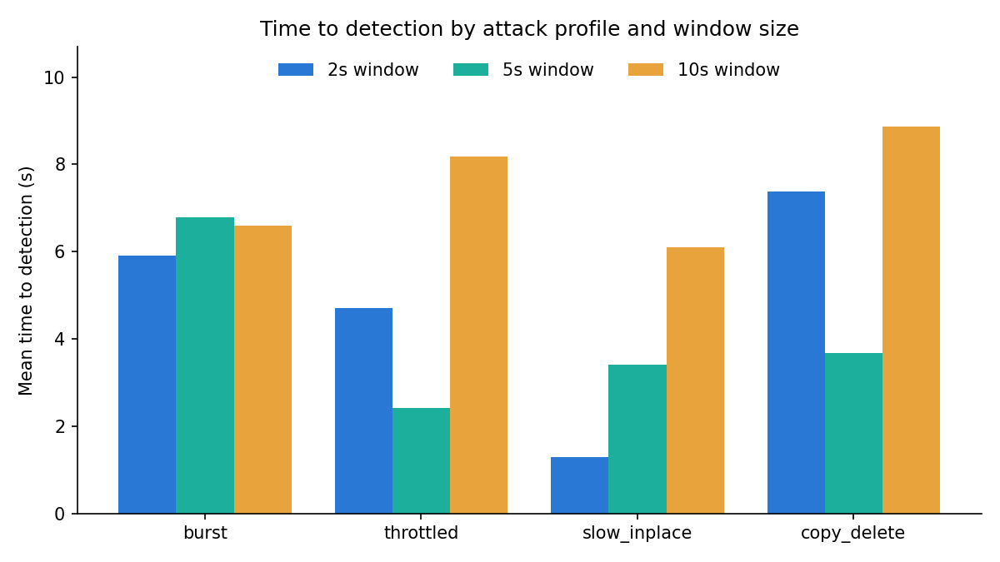
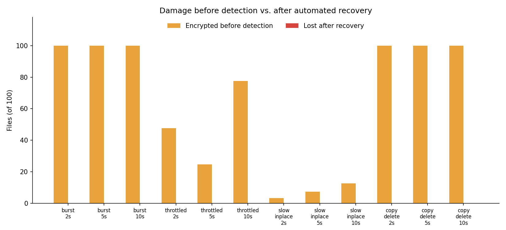

# EarlyShield — Real-Time Evaluation Results

Generated 2026-10-25 08:30 UTC on win32, Python 3.12.10, PollingObserver · corpus of 100 files · auto-response threshold 0.50 · 3 trial(s) per attack configuration.

## Ransomware simulations

TTD = time from the attacker's first encrypted file to the model flagging a window. "Before detection" = files the attacker had already encrypted at that moment. "Lost" = corpus files not byte-identical to the original at the end of the trial, after automated recovery. "Responded" = the detection's confidence reached the auto-response threshold, so files were quarantined and restored; below it EarlyShield only raises an alert. "Confidence" = mean of each trial's highest flagged-window confidence. "Attribution" = share of flagged windows blamed on the attacker's PID.

| Attack | Window | Detected | Responded | Confidence | TTD (s) | Encrypted before detection | Encrypted total | Lost after recovery | Artifacts left | Attribution |
|---|---|---|---|---|---|---|---|---|---|---|
| burst | 2s | 3/3 | 3/3 | 0.94 | 5.9 ± 2.9 | 100.0 ± 0.0 | 100 ± 0 | 0.0 ± 0.0 | 0.0 ± 0.0 | 0% |
| burst | 5s | 3/3 | 3/3 | 0.94 | 6.8 ± 2.2 | 100.0 ± 0.0 | 100 ± 0 | 0.0 ± 0.0 | 0.0 ± 0.0 | 0% |
| burst | 10s | 3/3 | 3/3 | 0.92 | 6.6 ± 4.8 | 100.0 ± 0.0 | 100 ± 0 | 0.0 ± 0.0 | 0.0 ± 0.0 | 0% |
| throttled | 2s | 3/3 | 3/3 | 0.94 | 4.7 ± 2.8 | 47.7 ± 28.0 | 100 ± 0 | 0.0 ± 0.0 | 0.0 ± 0.0 | 0% |
| throttled | 5s | 3/3 | 3/3 | 0.94 | 2.4 ± 0.4 | 24.7 ± 3.8 | 100 ± 0 | 0.0 ± 0.0 | 0.0 ± 0.0 | 0% |
| throttled | 10s | 3/3 | 3/3 | 0.93 | 8.2 ± 2.9 | 77.7 ± 21.1 | 100 ± 0 | 0.0 ± 0.0 | 0.0 ± 0.0 | 0% |
| slow_inplace | 2s | 3/3 | 3/3 | 0.56 | 1.3 ± 0.2 | 3.3 ± 0.6 | 80 ± 0 | 0.0 ± 0.0 | 0.0 ± 0.0 | 0% |
| slow_inplace | 5s | 3/3 | 3/3 | 0.54 | 3.4 ± 0.9 | 7.3 ± 1.5 | 80 ± 0 | 0.0 ± 0.0 | 0.0 ± 0.0 | 0% |
| slow_inplace | 10s | 3/3 | 3/3 | 0.54 | 6.1 ± 4.5 | 12.7 ± 9.1 | 80 ± 0 | 0.0 ± 0.0 | 0.0 ± 0.0 | 0% |
| copy_delete | 2s | 3/3 | 3/3 | 0.77 | 7.4 ± 0.2 | 100.0 ± 0.0 | 100 ± 0 | 0.0 ± 0.0 | 0.0 ± 0.0 | 0% |
| copy_delete | 5s | 3/3 | 3/3 | 0.87 | 3.7 ± 0.1 | 100.0 ± 0.0 | 100 ± 0 | 0.0 ± 0.0 | 0.0 ± 0.0 | 0% |
| copy_delete | 10s | 3/3 | 3/3 | 0.90 | 8.9 ± 2.1 | 100.0 ± 0.0 | 100 ± 0 | 0.0 ± 0.0 | 0.0 ± 0.0 | 0% |

**Overall:** 36/36 attack trials detected; mean TTD 5.44 s; mean 64.4% of the corpus encrypted before detection; mean 0.0% lost after recovery; mean automated response time 1554 ms.

## Benign workloads (false positives)

A false positive here also triggers the automated response, so "Collateral actions" counts the quarantine/restore actions EarlyShield took on legitimate activity (all reversible: quarantined files are moved into the vault, not deleted).

| Workload | Window | Flagged trials | Flagged windows | Max confidence | Collateral actions |
|---|---|---|---|---|---|

## Charts

